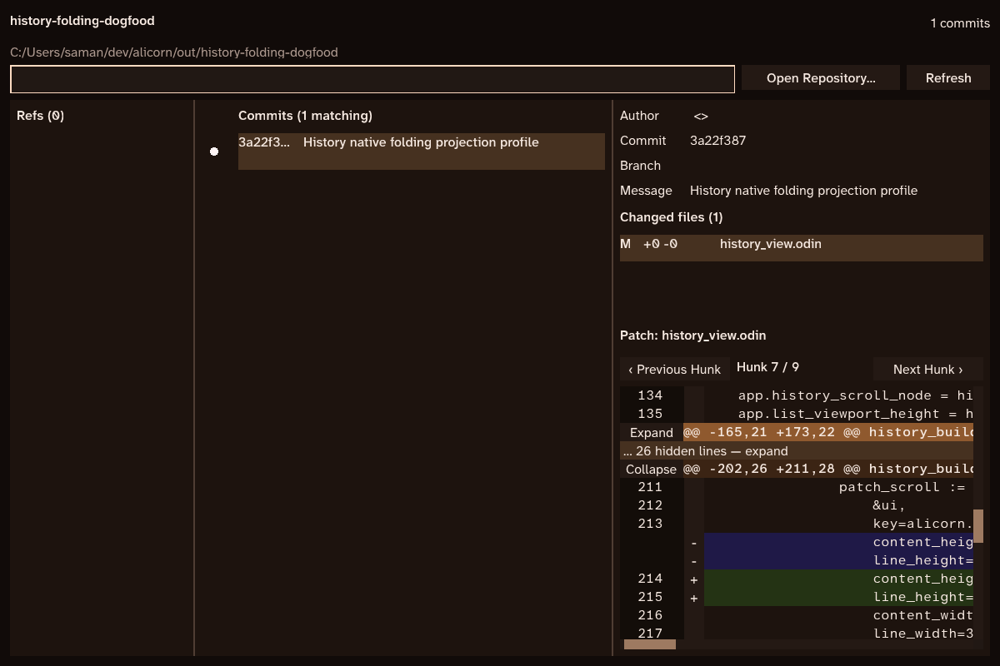

# Binary block folding dogfood — Alicorn #50

Status: implemented as opt-in `--folding` on History branch `codex/folding-projection`, based on master `e0eb3d4f8f59760d7a1c0d5071f60f080adc1b01`. The native dependency remains pinned at `3b8b5e872368d6540397972ddf4b490470bf5634`. This is an application projection experiment; no generic measured-sequence package is introduced.

## Behavior and ownership

Hunk headers expose Collapse/Expand. Each hidden body produces one placeholder; its old/new source extents and header remain unchanged. Hunks may span any number of fixed blocks, and several hunks may be hidden together. A gutter control selects a source row. Its logical identity survives hiding and virtual-node retirement and is highlighted again on expansion. This is row selection, not byte-range text selection.

Folding captures the top source target and fractional logical-pixel offset. A hidden target resolves to its placeholder while retaining its original source intent for expansion. Later scrolling supersedes that bookmark; explicit hunk navigation takes priority over a pending fold restore. Horizontal offset is retained, and hunk controls compensate for it so their labels remain reachable. Restoration waits until the new viewport geometry is laid out, then uses Alicorn's normal clamping and bounded corrective description.

The Git worker continues producing owned parsed patches. Existing request-ID/path checks reject stale results before UI adoption. The UI then builds and owns its projection, drops the expanded display array after successful preparation, and destroys all projection/viewport references before releasing the parsed patch. A new patch epoch clears selection and pending view requests. Workers never mutate the projection; there are no tree locks, persistent snapshots, or new production polling callbacks.

## Representation and API

`patch_projection.odin` imports only `core:mem`. It stores 16-byte span references into immutable parsed hunks, groups them into 32-reference blocks, and caches exact integer summaries in a contiguous binary directory. Same-kind source runs stay compressed. Source positions are never rewritten by folding. Rather than splice spans, the first body span of a hidden hunk contributes one displayed row and its remaining body spans contribute zero; all still contribute their original source extents. Folding recomputes affected blocks and their ancestor union in O(affected blocks + log(block count)).

Public old-file lines, new-file lines, displayed rows, hunk ordinals, source-line indexes, byte offsets and logical-pixel Y offsets are distinct types. Positions and counts also have different types. File line numbers are one-based; display rows and hunk/source indexes are zero-based. Public queries include `patch_projection_seek_old`, `patch_projection_seek_new`, `patch_projection_seek_hunk`, `patch_projection_viewport`, and `patch_projection_resolve`. The axis-selecting engine is private to the file. Integer combination rejects negative/overflowing counts. Preparation validates source continuity and is committed only after successful allocation and summary construction; failure preserves an existing projection and leaves the display-array fallback usable.

The source model and folding policy belong to History. This implementation provides neither pluggable index backends nor balanced-tree mutation. Partial-hunk folds, editable source, arbitrary insert/remove/splice, shared mutation and extraction remain outside this dogfood.

## Validation

The full History self-test passed, including existing parser, asynchronous delivery, layout/adaptive navigation, and commit-DAG checks. Added tests compare borrowed text and coordinates with the existing display array; check mixed/zero-count hunks, empty/binary patches, simultaneous folds, exact source dimensions, invalid coordinates, count overflow, nil-allocation failure, and stale worker epochs. A 200-line alternating hunk crosses multiple blocks. Queries and folds allocate nothing after preparation, and tracked index storage is released on destruction.

Real runtime tests use registered font bytes and resolved scroll geometry to verify fractional vertical and horizontal restoration, logical selection retention, and navigation superseding a pending anchor. The actual History gutter, header and placeholder controls are activated through semantic Press actions. Four negative compilation checks reject new-line/old-line confusion, pixel/display-row confusion, position/count confusion, and source-line/hunk confusion.

Native validation ran on Windows 10 build 19045, Direct3D 12, 1200 × 800 logical/physical pixels at 100% scale, with Odin `dev-2026-09-nightly:a2fb372`, `-o:speed -thread-count:1`. Each process runs a finite 38-step scheduled script and exits after three seconds. It uses the actual `history_view.odin` patch from `3a22f387ef4003da82eea53aa27657471c71a899`: 128 displayed rows, nine hunks, and 68 compact spans. All six final native processes completed with zero script failures and zero stabilization-limit hits. Ordinary application mode keeps `on_tick=nil`; scheduling is enabled only by the explicit profile modes.

The script exercises two simultaneous folds, hiding the current scroll/selection target, expansion, and later scrolling, then performs the same 29 ordinary viewport presentations in each mode. It invokes application commands in the real native event loop; it is not a recorded human mouse/keyboard session. Input control activation is covered by the separate semantic-action tests.

## Native measurements

Three sequential paired processes per mode were captured on 2026-10-14 local time. The capture bundle names use UTC and therefore begin `20261015`. Raw stdout, source-file hashes and compiler identity are in [the log](native-folding-windows-2026-10-14.txt); per-presentation stage values are in [the active-stage data](native-folding-active-stages-windows-2026-10-14.json).

| Measurement | Expanded array | Binary block folding |
| --- | ---: | ---: |
| Warm build p50, median across processes | 0.933 ms | 0.926 ms |
| Warm build p95, median across processes | 1.346 ms | 1.291 ms |
| Process-level warm build p95 range | 1.267–1.475 ms | 1.203–1.472 ms |
| Active CPU-stage p95, median across processes | 2.713 ms | 2.231 ms |
| Process-level active CPU-stage p95 range | 2.658–3.061 ms | 1.779–2.395 ms |
| Settled display-index + viewport-buffer capacity | 7,224 B | 4,392 B |

Build timing covers the real History description, retained layout and text measurement. Active CPU stages sum the flight recorder's application-build, GPU-encode and submission times for the 29 ordinary presentations. Encoding includes native text-mesh work. These stage sums exclude event waits, fence waits and GPU execution, and are not input-to-display latency. The host's global `frame_p95` includes thousands of idle/deadline-loop samples; it must not be substituted for active viewport cost. The extraction excludes the final held/capture views and retains every selected per-presentation value for inspection.

The compact build is about 4% lower at the process-median p95, within the 5% ordinary-build regression guardrail for this fixture. The small corpus, three processes, and driver/timing variance do not establish a general speedup. Fold/corrective-build p95 medians were 1.247 ms across 13 builds per compact process. This is useful native evidence for continuing dogfooding, not a performance claim about arbitrary dynamic mutation or large human workflows.

The compact memory figure is 2,048 B span capacity + 288 B hunk states + 256 B directory + 1,800 B reusable viewport rows. It includes the view's extra staging storage and is approximately 39% below the expanded display array. Both retain the same parsed patch strings/hunks. These are requested payload capacities, excluding allocator/process overhead, renderer caches and peak preparation. The worker still temporarily builds the expanded fallback. No 50% full-application memory reduction is claimed.

An earlier nested per-row button prototype exceeded the ordinary build guardrail. The final view keeps the existing row structure and places selection in the gutter, replacing its old marker text node. The log and source hashes refer to this final implementation.

## Remaining decision

Continue opt-in History dogfooding with the binary directory. A larger representative patch corpus, native DPI/other-platform runs, recorded reader interaction traces, and arbitrary fold policies still need evidence before default adoption. The current read-only whole-hunk model has no measured need for B+ tree balancing, concurrency, or a standalone library. Alicorn's variable-height sparse index remains the selected representation.
